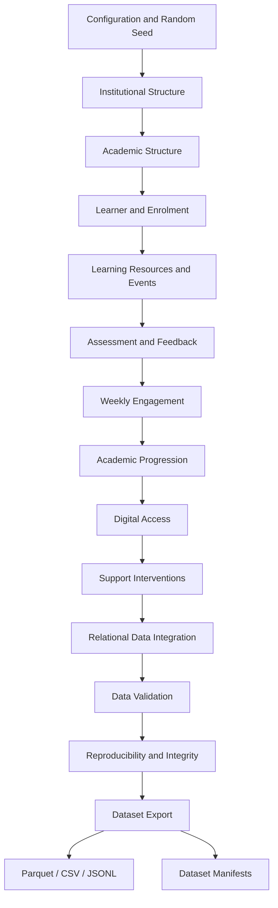

# EduTrace-Open

### A Synthetic Longitudinal Multimodal Dataset of Learning Activities, Assessment Interactions, and Educational Progression in Higher Education

<p align="center">

**An Open Research Dataset and Reproducible Synthetic Data Generation Framework**

</p>

<p align="center">

[](https://doi.org/10.5281/zenodo.24124573)
[](https://github.com/drsanjayagal/EduTrace-Open)
[](LICENSE)
[](https://www.python.org/)
[](https://doi.org/10.5281/zenodo.24124573)

</p>

---

## 1. Overview

**EduTrace-Open** is an open research initiative that provides a reproducible, configurable, and scalable framework for generating synthetic longitudinal multimodal educational datasets for higher education research.

The project models interconnected educational processes, including institutional structures, learner profiles, academic enrolments, learning resources, learning activities, assessment interactions, feedback, weekly engagement, academic progression, digital accessibility, and academic support interventions.

The framework generates a relational dataset comprising **16 interconnected tables**, organized into seven functional components.

The published dataset is available through Zenodo with a permanent Digital Object Identifier (DOI), enabling researchers to access and cite the research output independently of the software repository.

EduTrace-Open is designed to facilitate research without requiring access to real student records, institutional databases, or proprietary Learning Management Systems (LMS).

### Key Contributions

- A synthetic longitudinal educational data generation framework.
- A 16-table relational educational data model.
- Integrated modelling of academic activities and assessment interactions.
- Synthetic learner engagement and progression trajectories.
- Multimodal educational information representation.
- Configurable generation across multiple dataset scales.
- Deterministic generation and reproducibility verification.
- Automated relational and structural validation.
- Open research dataset publication through Zenodo.
- Reusable software infrastructure for educational AI research.

> **Synthetic Data Declaration:** All records generated by EduTrace-Open are simulated. They do not represent real students, individuals, educational institutions, LMS platforms, actual assessments, or interventions. The generated relationships are computational modelling assumptions and must not be interpreted as empirical educational findings.

---

## 2. Research Dataset and Repository

EduTrace-Open maintains two complementary research resources.

| Resource | Description | Persistent Link |
|---|---|---|
| Research Dataset | Published synthetic educational dataset | [Zenodo DOI](https://doi.org/10.5281/zenodo.24124573) |
| Source Code | Python-based synthetic data generation framework | [GitHub Repository](https://github.com/drsanjayagal/EduTrace-Open) |
| Researcher Profile | Author's research and software contributions | [GitHub Profile](https://github.com/drsanjayagal) |

### Dataset Identification

| Metadata | Details |
|---|---|
| Dataset Name | EduTrace-Open |
| Dataset DOI | 10.5281/zenodo.24124573 |
| DOI URL | https://doi.org/10.5281/zenodo.24124573 |
| Repository | https://github.com/drsanjayagal/EduTrace-Open |
| Dataset Type | Synthetic longitudinal multimodal educational dataset |
| Domain | Higher Education |
| Data Model | Relational, longitudinal |
| Number of Tables | 16 |
| Functional Components | 7 |
| Data Classification | Fully synthetic |
| Publication Platform | Zenodo |
| Software Version | 0.1.0 |

---

## 3. Research Objectives

The primary objective of EduTrace-Open is to establish an accessible and reproducible synthetic educational data infrastructure for research in Artificial Intelligence, Machine Learning, and Educational Data Mining.

The specific objectives are:

1. Develop a structured synthetic representation of higher education environments.
2. Model learner-level academic activities and educational interactions.
3. Represent assessment performance and feedback interactions.
4. Simulate longitudinal engagement and academic progression.
5. Integrate digital accessibility and support intervention information.
6. Provide relationally consistent and reproducible synthetic datasets.
7. Support benchmarking of educational machine learning algorithms.
8. Facilitate privacy-aware research without requiring real learner records.

---

## 4. Dataset Structure

The dataset contains 16 interconnected relational tables organized into seven functional components.

### 4.1 Institutional and Academic Structure

This component represents the organizational and academic foundation of a synthetic higher education environment.

| Table | Description |
|---|---|
| `institution` | Synthetic institutional records |
| `programme` | Academic programme information |
| `course` | Course-level records |
| `module` | Academic module information |
| `curriculum_dependency` | Curriculum dependency relationships |

### 4.2 Learner and Enrolment

This component represents synthetic learner profiles and their academic enrolment relationships.

| Table | Description |
|---|---|
| `learner` | Synthetic learner profiles |
| `enrolment` | Learner academic enrolment records |

### 4.3 Learning Resources and Activities

This component captures learning resources and simulated interactions with educational activities.

| Table | Description |
|---|---|
| `learning_resource` | Learning resource records |
| `learning_event` | Learning activity interaction events |

### 4.4 Assessment and Feedback

This component represents assessment structures, learner attempts, and feedback interactions.

| Table | Description |
|---|---|
| `assessment_item` | Assessment definitions |
| `assessment_attempt` | Learner assessment attempts |
| `feedback_event` | Assessment feedback interactions |

### 4.5 Weekly Engagement and Learning Trajectories

This component represents longitudinal learner engagement patterns across academic weeks.

| Table | Description |
|---|---|
| `weekly_engagement` | Weekly learner engagement records |

### 4.6 Academic Progression and Digital Access

This component captures academic progression and simulated digital access characteristics.

| Table | Description |
|---|---|
| `progression_event` | Academic progression events |
| `digital_access` | Synthetic digital access records |

### 4.7 Academic Support Interventions

This component represents synthetic academic support activities and intervention records.

| Table | Description |
|---|---|
| `support_event` | Academic support intervention records |

### Dataset Summary

| Component | Number of Tables |
|---|---:|
| Institutional and Academic Structure | 5 |
| Learner and Enrolment | 2 |
| Learning Resources and Activities | 2 |
| Assessment and Feedback | 3 |
| Weekly Engagement | 1 |
| Progression and Digital Access | 2 |
| Support Interventions | 1 |
| **Total** | **16** |

---

## 5. Dataset Architecture

EduTrace-Open follows a modular data-generation architecture in which institutional, academic, learner, learning, assessment, and longitudinal components are integrated through relational identifiers.

### Conceptual Data Flow



### Architectural Principles

- Modular generation components.
- Controlled random-state management.
- Relational consistency.
- Schema-driven data generation.
- Longitudinal temporal modelling.
- Configurable dataset sizes.
- Automated validation.
- Reproducible execution.
- Standardized data storage.

---

## 6. Development and Implementation

EduTrace-Open has been developed through 11 implementation phases.

| Phase | Development Area | Deliverables | Status |
|---|---|---|---|
| 1 | Repository Foundation | Configuration, constants, exceptions, logging, schemas, utilities | Complete |
| 2 | Institutional Structure | Institution and programme generation | Complete |
| 3 | Academic Structure | Course, module, and curriculum dependency generation | Complete |
| 4 | Learner Modelling | Learner profile and enrolment generation | Complete |
| 5 | Learning Activity Generation | Learning resources and learning events | Complete |
| 6 | Assessment Modelling | Assessment items, attempts, and feedback | Complete |
| 7 | Longitudinal Modelling | Weekly engagement and academic progression | Complete |
| 8 | Digital Access and Interventions | Digital access and support event generation | Complete |
| 9 | Data Integration and Validation | Relational integration, validation, and storage | Complete |
| 10 | Reproducibility and Documentation | Hashing, manifests, testing, and technical documentation | Complete |
| 11 | Packaging and Release | Python package, CLI, configuration profiles, and release preparation | Complete |

The implementation includes modular generators, configuration management, schema definitions, a generation pipeline, validation utilities, export functionality, and command-line execution.

---

## 7. Dataset Generation Profiles

The framework supports four predefined generation configurations.

| Profile | Learners | Programmes | Academic Years | Intended Application |
|---|---:|---:|---:|---|
| Pilot | 200 | 2 | 2 | Software verification |
| Default | 1,000 | 5 | 3 | Research experiments |
| Standard | 10,000 | 8 | 3 | Standard-scale research |
| Large | 100,000 | 15 | 4 | Large-scale experimentation |

The generation parameters are configurable through YAML configuration files.

The large profile is implemented as a configuration but has not yet been verified through end-to-end execution in the documented release environment.

---

## 8. Technical Specifications

| Specification | Technology / Implementation |
|---|---|
| Programming Language | Python |
| Minimum Python Version | 3.11 |
| Tested Python Version | 3.12 |
| Data Processing | Polars |
| Configuration | YAML |
| Primary Data Format | Apache Parquet |
| Additional Formats | CSV, JSONL |
| Randomization | Controlled random-state management |
| Data Integrity | Schema and relational validation |
| Reproducibility | Stable hashing and deterministic generation |
| Testing | pytest |
| Code Quality | Ruff |
| Execution | Local command-line interface |

### System Requirements

Indicative resource requirements:

| Profile | RAM | Storage |
|---|---|---|
| Pilot | Approximately 1 GB | Approximately 200 MB |
| Standard | Approximately 4–8 GB free RAM | Approximately 1–2 GB |
| Large | Not benchmarked | Not benchmarked |

Actual resource consumption depends on the system, configuration, and output formats.

The framework does not require external APIs, cloud databases, or hosted services for local generation.

---

## 9. Installation

### 9.1 Clone the Repository

```bash
git clone https://github.com/drsanjayagal/EduTrace-Open.git

cd EduTrace-Open
```

### 9.2 Create a Virtual Environment

```bash
python -m venv .venv
```

### 9.3 Activate the Environment

**Windows PowerShell:**

```powershell
.venv\Scripts\Activate.ps1
```

**Linux / macOS:**

```bash
source .venv/bin/activate
```

### 9.4 Upgrade pip

```bash
python -m pip install --upgrade pip
```

### 9.5 Install Dependencies

```bash
pip install -e ".[dev]"
```

### Python Version Recommendation

Python 3.12 is the tested environment for this release.

For Windows systems with multiple Python versions:

```powershell
py -3.12 -m venv .venv
```

---

## 10. Quick Start

### Generate a Pilot Dataset

```bash
python -m edutrace generate --config configs/pilot.yaml
```

### Generate the Default Dataset

```bash
python -m edutrace generate --config configs/default.yaml
```

### Generate the Standard Dataset

```bash
python -m edutrace generate --config configs/standard.yaml
```

### Inspect Generated Data

```bash
python -m edutrace inspect --input data/generated
```

### Validate Generated Data

```bash
python -m edutrace validate --input data/generated --strict
```

### Verify Reproducibility

```bash
python -m edutrace verify --config configs/pilot.yaml
```

---

## 11. Command-Line Interface

The framework provides the following commands:

| Command | Function |
|---|---|
| `generate` | Generate synthetic educational datasets |
| `validate` | Validate generated datasets |
| `inspect` | Produce descriptive summaries |
| `export` | Export Parquet datasets into additional formats |
| `verify` | Verify deterministic generation using repeated execution |
| `version` | Display software version |

Display available commands:

```bash
python -m edutrace --help
```

### Generation Options

| Argument | Description |
|---|---|
| `--config PATH` | YAML configuration file |
| `--seed INT` | Override random seed |
| `--output DIR` | Override output directory |
| `--learners INT` | Override learner count |
| `--years INT` | Override academic year count |
| `--chunk-size INT` | Override pipeline chunk size |
| `--format FMT` | Select Parquet, CSV, or JSONL |
| `--no-checkpoint` | Ignore existing checkpoint |
| `--reset-checkpoint` | Reset checkpoint state |
| `--log-level LEVEL` | Set logging level |

---

## 12. Output Organization

Generated datasets are organized into functional directories.

```text
data/generated/
│
├── institutional/
│   ├── institution.parquet
│   └── programme.parquet
│
├── academic/
│   ├── course.parquet
│   ├── module.parquet
│   └── curriculum_dependency.parquet
│
├── learners/
│   ├── learner.parquet
│   ├── enrolment.parquet
│   └── progression_event.parquet
│
├── learning/
│   ├── learning_resource.parquet
│   ├── learning_event.parquet
│   └── weekly_engagement.parquet
│
├── assessment/
│   ├── assessment_item.parquet
│   ├── assessment_attempt.parquet
│   └── feedback_event.parquet
│
├── accessibility/
│   └── digital_access.parquet
│
├── interventions/
│   └── support_event.parquet
│
├── manifests/
│   ├── dataset_manifest.json
│   ├── file_checksums.json
│   └── schema_manifest.json
│
└── validation/
    └── validation_report.json
```

Parquet is the primary storage format. CSV and JSONL are optional export formats.

---

## 13. Data Validation and Quality Assurance

The validation framework evaluates the structural and relational integrity of generated datasets.

### Validation Dimensions

1. Structural integrity.
2. Foreign-key integrity.
3. Temporal ordering.
4. Distribution sanity.
5. Cross-table consistency.
6. Reproducibility.
7. Data leakage checks.

### Execute Strict Validation

```bash
python -m edutrace validate \
    --input data/generated \
    --strict
```

### Generate a Validation Report

```bash
python -m edutrace validate \
    --input data/generated \
    --strict \
    --report out/validation.json
```

The validation framework produces structured results to support quality assessment and verification.

---

## 14. Reproducibility

Reproducibility is a fundamental design principle of EduTrace-Open.

The framework uses controlled random seeds and stable hashing mechanisms to support repeatable synthetic data generation.

### Reproducibility Verification

```bash
python -m edutrace verify --config configs/pilot.yaml
```

Standard-scale verification:

```bash
python -m edutrace verify --config configs/standard.yaml
```

The standard-scale verification executes the pipeline twice and takes approximately 75 minutes in the documented release environment.

### Reproducibility Characteristics

- Deterministic table values under identical configurations and seeds.
- Stable per-table hash comparison.
- Repeatable generation procedures.
- Controlled random-state management.
- Checkpoint-aware execution.

**Important:** The documented guarantee covers table values. Identifier consistency depends on the documented chunk-size conditions.

---

## 15. Experimental Verification

The following results represent the documented execution and verification status of EduTrace-Open version 0.1.0.

### 15.1 Generation Results

| Profile | Generation Result | Validation | Reproducibility |
|---|---|---|---|
| Pilot | Successfully executed | 41/41 checks | Verified across 2 runs |
| Standard | 9.16 million learning events | 42/42 checks | Verified across 2 runs |
| Large | Not executed end-to-end | Not available | Not verified |

### 15.2 Execution Performance

| Profile | Observed Execution Time |
|---|---|
| Pilot | Under 1 minute |
| Standard | Approximately 37–40 minutes |
| Large | Not benchmarked |

These timings represent the documented Windows 11 release environment and should not be generalized to all hardware configurations.

### 15.3 Software Verification

The following commands have been successfully executed in the documented release environment.

**Automated testing:**

```bash
python -m pytest -q
```

Result: All tests pass.

**Code quality:**

```bash
ruff check src tests scripts
```

Result: Clean.

**Dataset inspection:**

```bash
python -m edutrace inspect --input data/generated
```

Result: No reported anomalies.

**Strict validation:**

```bash
python -m edutrace validate --input data/generated --strict
```

Result: Exit code 0.

### 15.4 Known Verification Limitations

The following have not been verified:

- End-to-end execution of the 100,000-learner profile.
- Reproducibility of the large profile.
- Peak memory consumption across all profiles.
- Cross-platform performance beyond Windows 11.
- GitHub Actions execution in the release environment.

---

## 16. Research Applications

EduTrace-Open is intended to support computational experimentation and methodological research across educational AI domains.

| Research Area | Potential Application |
|---|---|
| Educational Data Mining | Learning behaviour and interaction pattern discovery |
| Learning Analytics | Learner engagement analysis |
| Longitudinal Analysis | Academic progression modelling |
| Predictive Analytics | Synthetic academic performance prediction |
| Early-Warning Systems | Simulated learner risk identification |
| Recommendation Systems | Educational resource recommendation experiments |
| Explainable AI | Model interpretation and explanation studies |
| Temporal Machine Learning | Sequential learning activity modelling |
| Accessibility Analytics | Digital access pattern analysis |
| Intervention Modelling | Academic support intervention simulation |
| Synthetic Data Research | Utility and quality evaluation |
| Data Engineering | Relational educational dataset processing |

### Suggested Research Directions

Researchers may use EduTrace-Open to investigate:

- Temporal learning activity representations.
- Multi-table educational data integration.
- Synthetic learner engagement modelling.
- Assessment interaction prediction.
- Longitudinal academic progression.
- Educational recommendation algorithms.
- Explainable educational machine learning.
- Synthetic-data quality and utility metrics.
- Robustness of machine learning under controlled data distributions.
- Reproducible benchmarking of educational AI algorithms.

---

## 17. Scientific Scope and Limitations

EduTrace-Open is a synthetic data generation framework, not an empirically collected educational dataset.

The generated records are intended for methodological development, controlled experimentation, software verification, and benchmarking.

The following limitations must be considered:

1. Synthetic records do not represent real learner populations.
2. Simulated distributions do not establish empirical educational distributions.
3. Artificial correlations do not demonstrate real-world causal relationships.
4. Model performance on synthetic records does not establish real-world predictive validity.
5. Findings should not be generalized to actual institutions or learners without independent empirical validation.
6. Large-scale execution and resource consumption require further verification.

Researchers should explicitly disclose the synthetic nature of the data when publishing results based on EduTrace-Open.

---

## 18. Privacy and Ethical Considerations

The framework is designed to generate educational data without requiring real student records.

### Privacy Principles

- No real learner records are required.
- No real institutional databases are required.
- No actual LMS activity logs are required.
- No real assessment submissions are required.
- Generated identities and interactions are simulated.
- Modelling assumptions should be transparently documented.

The synthetic nature of the dataset does not automatically establish the privacy properties of every possible downstream use. Researchers should evaluate their own data-processing and publication practices.

Detailed documentation:

`docs/privacy_and_ethics.md`

---

## 19. Documentation

The repository includes detailed technical documentation.

| File | Description |
|---|---|
| `docs/architecture.md` | Software and pipeline architecture |
| `docs/data_dictionary.md` | Dataset tables and column definitions |
| `docs/relational_schema.md` | Relational schema and foreign-key graph |
| `docs/generation_methodology.md` | Synthetic data generation methodology |
| `docs/simulation_assumptions.md` | Simulation assumptions |
| `docs/validation_methodology.md` | Data validation methodology |
| `docs/reproducibility.md` | Reproducibility guarantees |
| `docs/performance.md` | Execution performance and limitations |
| `docs/privacy_and_ethics.md` | Privacy and ethical considerations |
| `docs/troubleshooting.md` | Common problems and solutions |
| `docs/execution_guide.md` | Platform-specific execution instructions |

---

## 20. Dataset Access and Download

The published EduTrace-Open dataset is available through Zenodo.

**Permanent Dataset Identifier:**

[https://doi.org/10.5281/zenodo.24124573](https://doi.org/10.5281/zenodo.24124573)

Researchers can use the Zenodo record to access the published dataset and its associated metadata.

The GitHub repository provides the source code and instructions for independently generating synthetic datasets.

### Recommended Access Routes

| Requirement | Resource |
|---|---|
| Access published dataset | [Zenodo Dataset](https://doi.org/10.5281/zenodo.24124573) |
| Access source code | [GitHub Repository](https://github.com/drsanjayagal/EduTrace-Open) |
| Reproduce dataset generation | GitHub installation and execution instructions |
| Understand dataset variables | `docs/data_dictionary.md` |
| Understand data relationships | `docs/relational_schema.md` |
| Understand simulation assumptions | `docs/simulation_assumptions.md` |

---

## 21. Citation

Researchers using the published EduTrace-Open dataset should cite the Zenodo record.

### Dataset Citation

Agal, S. (2026). *EduTrace-Open: A Synthetic Longitudinal Multimodal Dataset of Learning Activities, Assessment Interactions, and Educational Progression in Higher Education*. Zenodo. https://doi.org/10.5281/zenodo.24124573

### BibTeX

```bibtex
@dataset{agal_edutrace_open_2026,
  author    = {Agal, Sanjay},
  title     = {EduTrace-Open: A Synthetic Longitudinal
               Multimodal Dataset of Learning Activities,
               Assessment Interactions, and Educational
               Progression in Higher Education},
  year      = {2026},
  publisher = {Zenodo},
  doi       = {10.5281/zenodo.24124573},
  url       = {https://doi.org/10.5281/zenodo.24124573}
}
```

### Software Citation

For work specifically using the generation framework, researchers should additionally cite the GitHub software repository and identify the software version used.

---

## 22. Licensing and Usage

The software source code is distributed under the MIT License. Refer to the repository `LICENSE` file for the applicable terms.

The published dataset is governed by the license specified in its Zenodo record. Users should consult the dataset record before redistributing or adapting the published data.

All records are synthetic and should be interpreted within the documented scientific and modelling limitations.

---

## 23. Author and Research Affiliation

**Dr. Sanjay Agal**

Professor & Head  
Department of Artificial Intelligence and Data Science  
Parul Institute of Engineering and Technology  
Faculty of Engineering & Technology  
Parul University  
Vadodara, Gujarat, India

**Research Interests:**

- Artificial Intelligence and Machine Learning
- Synthetic Data Generation
- Educational Data Mining
- Learning Analytics
- Privacy-Preserving Machine Learning
- Longitudinal Data Modelling
- Data Engineering and Reproducible Research

**Email:** sanjay.agal32685@paruluniversity.ac.in

**GitHub:** https://github.com/drsanjayagal

---

## 24. Acknowledgement

EduTrace-Open is developed as an open research contribution to support reproducible experimentation in educational data science and artificial intelligence.

The project aims to make synthetic educational data infrastructure more accessible to researchers, developers, and academic institutions working on learning analytics, educational data mining, and AI-driven educational research.

---

<p align="center">

# EduTrace-Open

### Building Reproducible Synthetic Educational Data Infrastructure

**Enabling Research in Artificial Intelligence, Learning Analytics, and Educational Data Mining**

**Author: Dr. Sanjay Agal**

Parul University, Vadodara, Gujarat, India

[GitHub Repository](https://github.com/drsanjayagal/EduTrace-Open) · [Published Dataset](https://doi.org/10.5281/zenodo.24124573)

</p>
